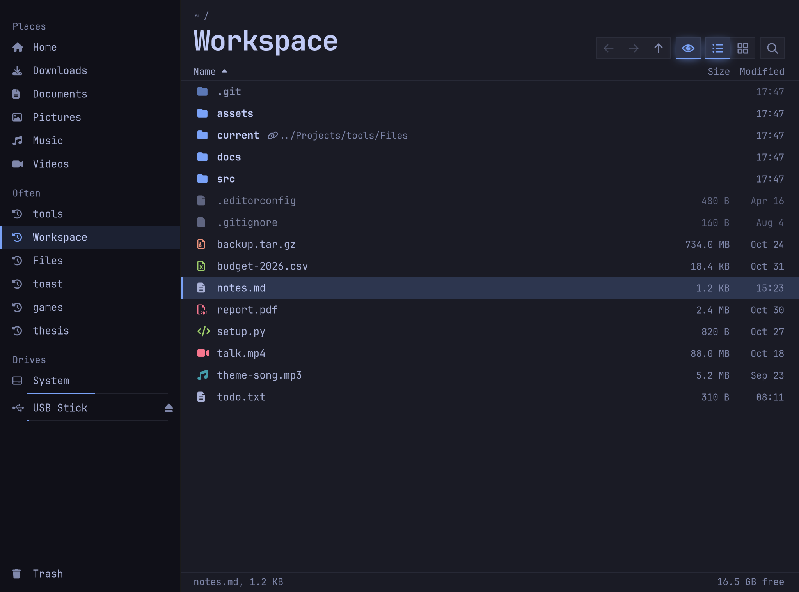
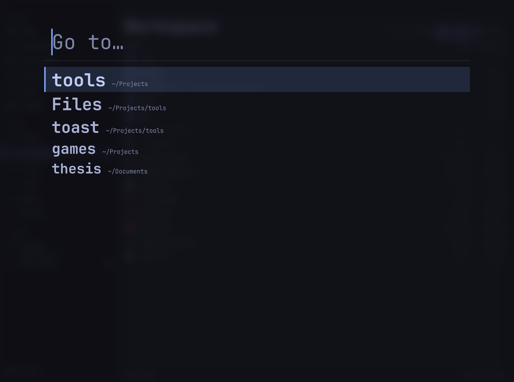
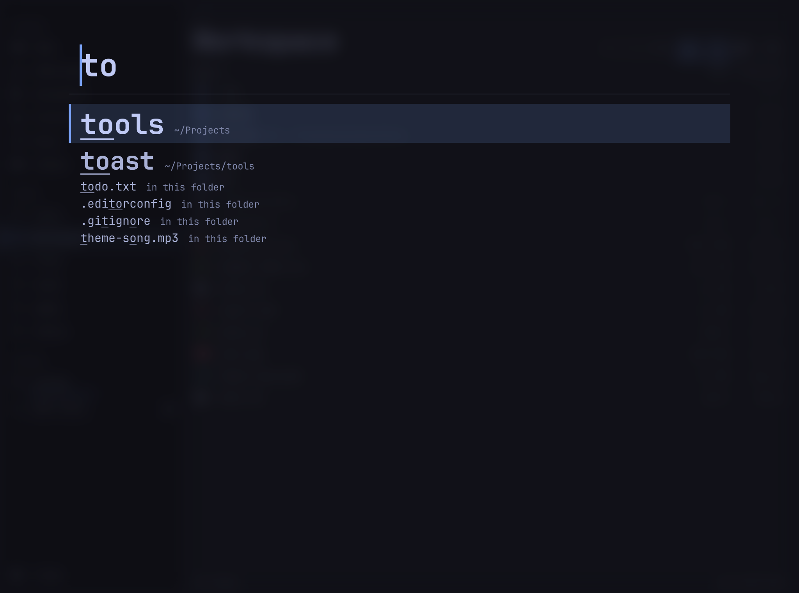
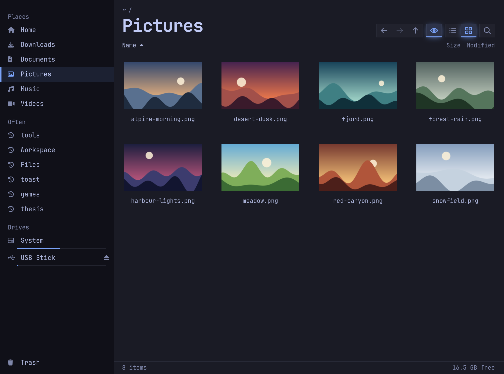
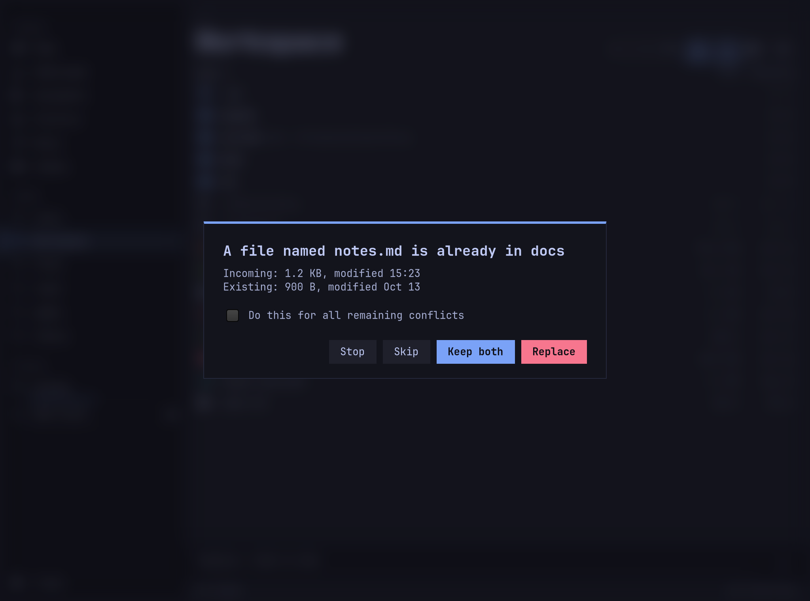
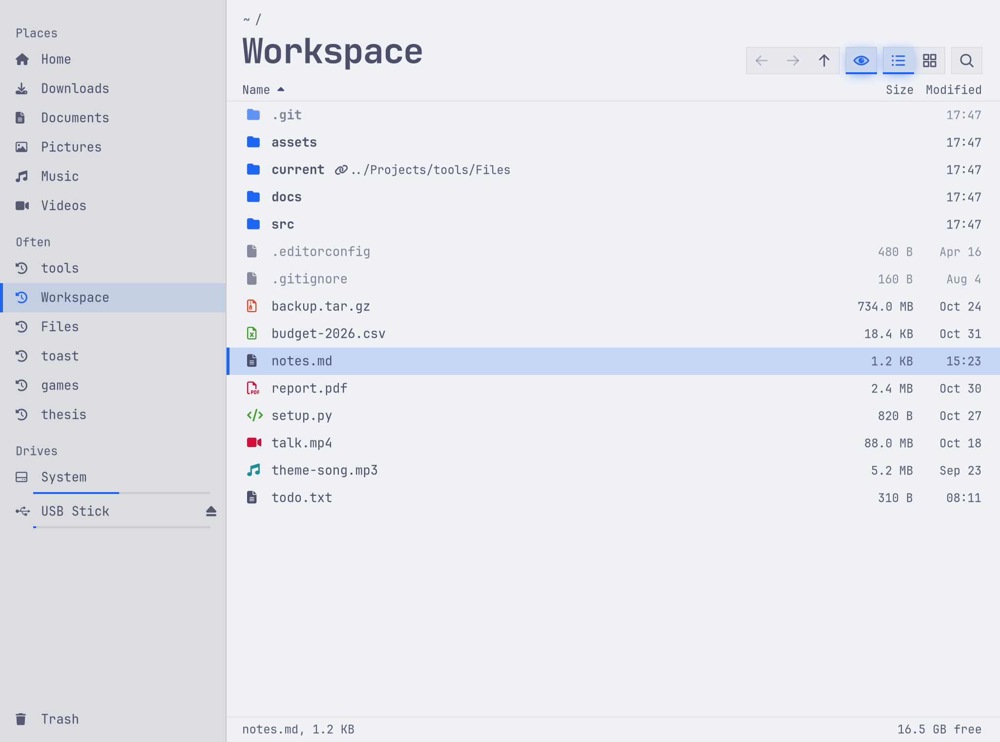
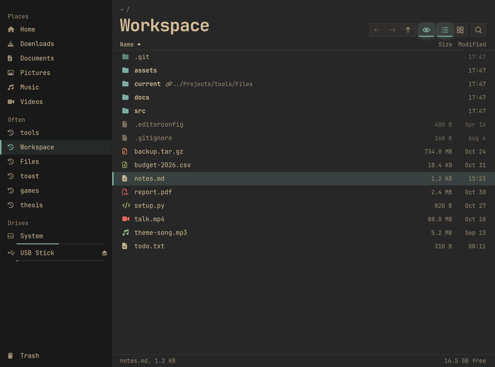
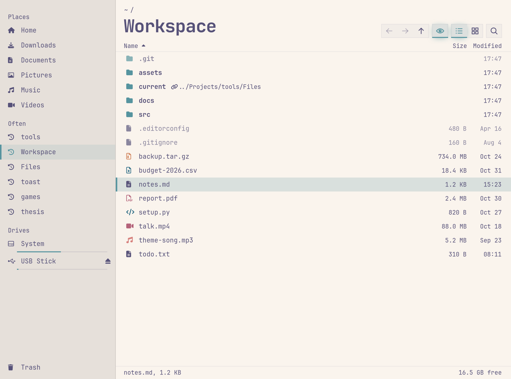

# Files

A keyboard-first file manager for [Omarchy](https://omarchy.org), replacing Nautilus (Omarchy's `SUPER+SHIFT+F` default). GTK4 and Python, nothing to build.

It searches the same data as the terminal: quick search reads zoxide's database and ranks folders the way `z` does, and folders you open here are added back to zoxide.



## Features

- **Jump anywhere by typing.** Start typing in any folder. The top hit always matches what `z` would pick, followed by names in the current folder and fuzzy matches.
- **Follows your Omarchy theme and font**, and switches when the theme changes.
- **Careful with your files.** Nothing is overwritten without an answer, a failed replace keeps the original, and Trash has Undo. The rules are under [Decisions](#decisions).
- **Plays well with the desktop.** It shares the clipboard with other apps and the bookmarks with GTK dialogs, reuses the shared thumbnail cache, and answers "show in folder" from browsers.
- **Everything is reachable.** Trash, phones and network shares come through gvfs, and `sftp://` addresses work when you type a path.
- **Stays responsive on huge folders.** 50,000 files list and sort in 2.3 s, with a longest UI freeze of 277 ms.

## Screenshots

| Quick search before typing | Quick search for `to` |
| --- | --- |
|  |  |

| Grid view with thumbnails | Conflict question |
| --- | --- |
|  |  |

| Catppuccin Latte | Gruvbox | Rosé Pine |
| --- | --- | --- |
|  |  |  |

The files and drives in these are made up. See [Tests](#tests) for how they're generated.

## Install

```
git clone https://github.com/SamiulH25/Files.git
cd Files
./install.sh
```

`install.sh` links to the checkout, so keep the folder where it is. It makes Files the default for `SUPER+SHIFT+F`, `SUPER+ALT+SHIFT+F` (opens at the terminal's folder), folder links and "show in folder". Every change is per-user and listed at the top of the script. `./install.sh --uninstall` undoes them and restores the previous default.

To try it without installing:

```
./files [path]
```

Needs `python-gobject`, `gtk4`, `zoxide`, `gvfs` (Trash, phones, network shares) and a Nerd Font, all on Omarchy by default. `ffmpegthumbnailer` and `poppler` add video and PDF thumbnails.

The keyboard shortcuts assume Omarchy's Hyprland config (`~/.config/hypr/bindings.lua`). Without that file the installer leaves them alone and everything else still works. Elsewhere the app falls back to built-in colours and any Nerd Font.

## Use

Opens where you left off, with hidden files showing (dimmed).

### Keys

| Key | Action |
| --- | --- |
| Start typing, `Ctrl+K` | Quick search. `Enter` goes, `Up`/`Down` choose, `Esc` closes |
| `/`, `~`, or `Ctrl+L` | Type a path (or `sftp://…`). `Tab` completes |
| `Enter`, double-click | Open |
| `Backspace`, `Alt+Up` | Parent folder |
| `Alt+Left`, `Alt+Right`, mouse side buttons | Back, forward |
| `Ctrl+H` | Show or hide hidden files |
| `Ctrl+1`, `Ctrl+2` | List, grid |
| `Ctrl+C`, `Ctrl+X`, `Ctrl+V` | Copy, cut, paste (shared with other apps) |
| `F2` | Rename |
| `Delete`, `Shift+Delete` | Move to Trash (with Undo), delete permanently (asks first) |
| `Ctrl+Shift+N` | New folder |
| `Ctrl+D` | Add to or remove from the sidebar |
| `F4` | Open a terminal here |
| `Ctrl+Shift+C` | Copy path |
| `F5` | Refresh |
| `Ctrl+N`, `Ctrl+W`, `Ctrl+Q` | New window, close, quit |

Dragging moves within a drive and copies across drives. `Ctrl` forces a copy and `Shift` a move.

## Code

| File | Job |
| --- | --- |
| `files` | Launcher. Uses system Python on purpose, since mise pythons don't have PyGObject |
| `filesapp/app.py` | `Gtk.Application`, theme reload, `org.freedesktop.FileManager1` D-Bus service |
| `filesapp/window.py` | The window: views, sidebar, quick search, menus, drag and drop |
| `filesapp/jump.py` | zoxide reading, ranking and path completion. No GTK |
| `filesapp/ops.py` | Copy, move, trash, delete and restore on worker threads. No GTK |
| `filesapp/theme.py` | Omarchy `colors.toml` to CSS |
| `filesapp/thumbs.py` | Thumbnails in the shared `~/.cache/thumbnails` cache |
| `filesapp/kinds.py` | File type glyphs and colours, size and date text |
| `filesapp/icons.py` | Toolbar icons drawn with cairo, including the animated eye |
| `filesapp/state.py` | `~/.local/state/files/state.json` |

## Tests

```
/usr/bin/python3 -m unittest discover -s tests   # logic and real file operations
tests/run_ui.sh [screenshot-dir]                 # drives the real window on a private Broadway display
```

Neither touches the desktop, focus or your zoxide data. The logic tests use the real Trash, with uniquely named files they clean up.

`/usr/bin/python3 tests/readme_shots.py docs/screenshots` regenerates the README screenshots from a made-up home folder. Use it for anything public: the screenshots from `run_ui.sh` show this machine's real drive names.

`tests/perf_check.py [count]` measures a huge folder (run it under Broadway, see `run_ui.sh`). `tests/wayland_check.py` runs the real app on the live session; its docstring shows how to keep it on a hidden workspace.

Last measured: 50,000 files listed and sorted in 2.3 s with a longest UI freeze of 277 ms.

Not automated: pointer drag and drop, real mouse clicks, real key presses (`press` in `ui_driver.py` calls the handler directly), and mounting real drives or phones. `handle_drop` and the job logic behind them are tested directly.

## Decisions

- **Top hit always equals `z`.** `jump.zoxide_match` is a port of zoxide's own matcher, and a test compares results against the real binary. Names in the current folder rank below exact zoxide hits, and fuzzy matches below those, so typing `tools` + `Enter` behaves the same everywhere. Change this order only on purpose.
- **Failed visits aren't recorded.** A folder only becomes the last folder or reaches zoxide once it has loaded, so permission errors don't pollute either.
- **Conflict rules in `ops.py` are data safety.** Nothing is overwritten without an answer, `Esc` means stop, and file-versus-folder can't be replaced. Replace copies beside the target and swaps it in, so a failed copy keeps the original. A move only removes a source folder once every child made it. Deletes never follow symlinks. A file reached through a symlinked folder is detected as the same file, because copying over itself would destroy it.
- **`secondary_text` instead of `muted` for text.** Many themes make `muted` too faint, so it's moved towards `foreground` until it reaches 4.5:1.
- **Toolbar icons are drawn, not Nerd Font glyphs.** Those glyphs are wider than their advance, so a centred label draws them 3-4px to the right. A test checks each drawn icon's ink is centred. File, sidebar and sort glyphs still come from the font.
- **No window decorations or rounded corners.** Hyprland draws the border and Omarchy's default is sharp corners. Translucency comes from CSS alpha over Hyprland's blur.

## Gotchas

- Window accels run before a focused widget, so plain keys like `BackSpace` never reach an entry in the main window. `_on_key` forwards keys to the quick search entry first. Popovers such as rename aren't affected.
- Clipboard reads must stay async. A synchronous read deadlocks when the copy came from this app, because the main loop fills that stream.
- `gvfsd-trash` lists a new item a moment after `trash()` returns, so undo retries before giving up.
- `Gtk.WidgetPaintable` draws nothing until pending layout is done. `tests/ui_driver.py` retries for that reason, and blank screenshots usually mean this.
- Toolbar icons read their colour when drawn, so they can keep the old theme's colours after a live switch until something redraws them. Seen under Broadway (`tests/readme_shots.py` forces a redraw for this reason), not yet checked on a live Wayland session.
- PyGObject initialises GTK when `Gtk` is imported, so a Broadway daemon has to be running before that import.
- An app with no window exits immediately, so anything creating its first window from an idle callback must `hold()` first.
- `XDG_CONFIG_HOME` beats `HOME`. To test `install.sh` in a throwaway home, unset it as well or `xdg-mime` writes to your real `mimeapps.list`:
  `env -u XDG_CONFIG_HOME -u XDG_DATA_HOME -u XDG_STATE_HOME -u XDG_RUNTIME_DIR HOME=$tmp ./install.sh`

## Not built yet

Tabs, split panes, a preview pane, recursive search across subfolders, folder sizes, a properties dialog, undo for anything except Trash, and a per-folder view setting. A `shortcut:` comment in the code marks each known limit.
